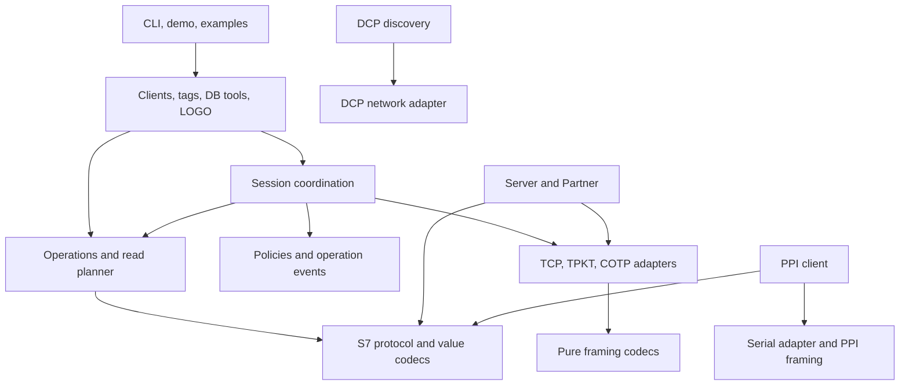

# Architecture Design

## Status & Goals

This is the target architecture for the features in the
[migration tracker](migration.md), based on its python-snap7 baseline. Implementation has started; consult the tracker for current capabilities. Module paths, interfaces, and Cargo features below
are proposed; introduce them incrementally with implementation and tests.
The tracker remains the source of truth for implementation progress.

Build an idiomatic Rust library that preserves supported S7 wire behavior,
keeps protocol logic testable without hardware, and shares behavior between
blocking and asynchronous clients. Use a small public interface over deep
modules that own validation, packet sizing, and error handling. Keep explicit
compatibility differences documented instead of copying Python implementation
details or unsupported stubs.

## Module Organization

Start with one library crate, `rs_snap7`. Multiple crates are unnecessary until
independent consumers or release requirements justify them. Re-export primary
client, configuration, address, and error types from `lib.rs`; keep wire details
and execution machinery private by default. The implemented `transport` module
is an explicit advanced interface for raw ISO-on-TCP consumers and protocol tests.
`protocol` exposes pure PDU models/codecs for custom services and independent peers;
client execution and session coordination remain internal.

| Planned module | Responsibility | Migration features |
| --- | --- | --- |
| `types`, `error` | Validated addresses, areas, configuration, result models, and typed errors | F01 |
| `codec` | Checked byte/value and date/time conversions, independent of I/O | F02–F03 |
| `transport` | Blocking and async TCP adapters, TPKT framing, COTP handshake/reassembly | F04 |
| `protocol` | S7 request/response encoding, validation, service messages, and reference checks | F05 |
| `session` | Negotiated limits, connection state, request references, and transaction coordination | F06, F11–F12 |
| `client` | Blocking `Client` and optional `AsyncClient`; configuration and operation entry points | F06–F09, F12 |
| `operations` | Shared read/write, chunking, diagnostics, control, block, password, and force workflows | F07–F09, F15–F19 |
| `planner` | Multi-read merging, packet budgets, result mapping, cache, and dispatch plans | F10 |
| `policy`, `observability` | Retry/heartbeat/limiter rules, operation events, and diagnostic reporting | F11, F13–F14 |
| `tags`, `db` | Address dialects, metadata imports, typed tag access, and DB row/layout tools | F20–F21 |
| `server` | Emulator sessions, registered memory, supported services, events, and callbacks | F22 |
| `logo`, `partner` | LOGO! addressing adapter and independent active/passive Partner sessions | F23–F24 |
| `ppi`, `discovery` | Serial PPI protocol/transport and independent PROFINET DCP discovery | F25–F26 |
| `src/bin/`, `examples/`, `tests/` | CLI/demo, runnable examples, and shared acceptance suites | F27–F28 |

These are responsibility groups, not a requirement to create a file for each
entry immediately. Split implementations when responsibilities warrant it;
avoid empty modules and pass-through wrappers.

## Dependency Direction

`types`, `error`, `codec`, `protocol`, and planning calculations do not depend
on clients, sockets, threads, or an async runtime. Transport does not know PLC
operations. Operations describe requests and consume validated responses;
session coordination executes them through the selected transport adapter.
PPI reuses applicable S7 data/request logic without depending on TCP sessions.
Discovery remains independent of classic S7 communication.

## Public Interface & Execution

- `Client` provides blocking connection, memory, and management operations.
  `AsyncClient` provides native asynchronous counterparts with the same models,
  validation rules, and supported behavior. Awaiting network I/O must not run
  blocking socket calls on an async executor.
- A validated configuration holds endpoint, rack/slot or explicit TSAPs,
  routing, timeouts, requested PDU size, recovery, and rate limits. Establishing
  a connection returns a usable client or an error; reconnecting renegotiates
  session limits. Explicit disconnect is supported; dropping releases resources.
- Use typed area/address/value models and `Result<T, Error>` rather than Python
  `ctypes`, numeric success sentinels, or caller-managed output buffers. Start
  with raw read/write operations; typed/tag conveniences reuse the same workflows.
- Blocking and async adapters share pure request builders, response decoders,
  chunk/read plans, and multi-step operation state. Only I/O, waiting, and lock
  acquisition differ. Introduce a private multi-step state machine when upload,
  download, or SZL continuation requires it, rather than duplicating workflows.
- Keep a small internal transport seam for production TCP and scripted test
  adapters. Blocking and async seams may differ; do not publish a universal
  transport trait or force one runtime model onto both. Public clients construct
  production adapters; internal constructors allow dependency injection in tests.

An ordinary read follows this sequence: validate address and size, calculate
chunks from negotiated limits, acquire the session, apply request limiting,
encode/send a request, validate/decode its response, and assemble the result.
Typed reads then use `codec`; tag reads resolve metadata before this sequence.

## Session Ownership & Concurrency

A session owns its transport, negotiated PDU/AMQ limits, request references,
connection state, and pending transaction state. Use explicit states such as
disconnected, negotiating, ready, and recovering. Failed negotiation must not
leave a partially usable session.

Initially permit one in-flight transaction per connection, including all
exchanges of a multi-step operation. Concurrent callers serialize through a
blocking or async session guard. Independent clients can operate concurrently.
Do not promise parallel exchanges on one connection before implementing
reference-based response dispatch and testing negotiated outstanding-job limits.

F10 uses `ClientPool`/`AsyncClientPool` with bounded, independent sessions.
Single-connection pipelining remains later work and would require a
dispatcher that routes responses to pending request references. A timeout
or cancellation must remove pending state and prevent late replies being reused.
Sequential execution alone does not complete F10's parallel-dispatch scope.

Heartbeat and reconnect use the same exclusive session coordination as normal
requests. Background work is opt-in, has bounded waits, and stops during shutdown;
it must never read directly from a socket owned by another operation. An async
operation cancelled after transmission invalidates the session unless its response
can be safely drained and matched. Explicit async disconnect may await cleanup;
`Drop` closes resources without requiring asynchronous work.

## Failure, Retry & Observability Rules

- Errors distinguish invalid input, transport/disconnection, timeout, malformed
  protocol, PLC response, authentication, rate limiting, and unsupported behavior.
  Preserve available protocol/item codes and underlying I/O causes. Return
  per-item outcomes for multi-variable operations; a failed item is not a
  successful zero-length read.
- Check all packet lengths, offsets, counts, and arithmetic before slicing or
  allocating. Bound reassembly size, continuation counts, stale-response retries,
  and total operation time. Never panic on malformed network input.
- Reconnect uses bounded backoff/jitter and fresh negotiation/reference state.
  Automatically retry only operations known to be safe, such as reads, or requests
  known not to have been sent. A lost acknowledgement after a write, download,
  control, or force operation can mean it already executed: report an ambiguous
  outcome instead of silently replaying it. A partially completed chunked write
  must expose known progress and uncertain scope.
- Each wire exchange consumes limiter capacity, including retries and heartbeat.
  Calculate waits with monotonic time and an operation deadline. Inject time and
  jitter sources for deterministic policy tests.
- Emit operation name, duration, result, connection context, and available codes.
  Invoke user hooks outside session locks and report a logical operation once;
  packet-level diagnostics remain separate. Never include passwords in logs.

## Server & Optional Modules

The server shares framing, protocol models, and codecs, but owns its own request
handlers and memory model. Registered areas validate access ranges and coordinate
reads/writes; each client connection has independent negotiation and references.
Document emulated services and limitations explicitly. Keep callbacks outside
memory/session locks and test clean shutdown with active clients.

LOGO! adapts address syntax and configuration over the standard client. Partner
owns its active/passive transfer lifecycle and acknowledgements. PPI owns serial
framing, checksums, retries, and its single-master/single-slave constraints.
DCP discovery owns its device model and network adapter; it does not use S7 TCP.
Tags and DB tools operate on decoded values and explicit layouts, without
introducing symbolic PLC access or automatic layout discovery.

## Dependencies & Cargo Features

Keep the default library blocking and runtime-independent, using `std::net` for
TCP. Introduce optional capabilities only with their implementations:

| Proposed feature | Purpose / dependency direction |
| --- | --- |
| `async` | Native async transport and coordination; Tokio is the proposed runtime |
| `server`, `partner` | Optional emulator and peer transfer implementations |
| `ppi`, `discovery` | Optional serial and DCP network adapters |
| `tag-import` | Optional CSV/JSON/XML metadata parsers; address parsing stays lightweight |
| `tracing` | Optional structured event adapter; applications own subscriber setup |
| `cli`, `demo` | Optional binaries/host metrics, depending on required library capabilities |

LOGO!, tag parsing, and DB layout helpers can reuse the core without a runtime
dependency. Select external crates and minimum supported Rust version when each
capability is implemented, after checking licensing and platform support. The `async` feature is now configured with optional Tokio; other entries remain
planned. Tokio socket I/O and absolute timeouts follow its
[transport](https://docs.rs/tokio/latest/tokio/net/struct.TcpStream.html) and
[timeout](https://docs.rs/tokio/latest/tokio/time/fn.timeout_at.html) interfaces. CI should eventually
check default, no-default, all-compatible, and individual optional feature builds.

## Test Architecture & Delivery

| Test layer | Main evidence |
| --- | --- |
| Pure module tests | Known byte vectors, round trips, invalid ranges, truncation, and arithmetic limits |
| Scripted transport tests | Partial reads/writes, stale/lost references, timeouts, cancellation, ambiguous writes, and recovery |
| Local integration tests | Client/server and Partner sessions, sync/async behavior parity, concurrency, shutdown, and CLI exit/output behavior |
| Compatibility tests | Pinned upstream vectors and observable behavior, including limits and error outcomes |
| Property/stress tests | Malformed input without panics, codec invariants, sustained sessions, and resource cleanup |
| Explicit hardware tests | Recorded CPU/firmware/configuration, read/write fixtures, and acceptance results |

Place reusable wire fixtures in `tests/fixtures/` and integration helpers in
`tests/common/`; keep private module tests beside implementations. Python may be
used by optional compatibility tooling, but normal `cargo test` must not require
Python, the ignored upstream checkout, or PLC hardware. Preserve fixture provenance
and applicable attribution. Test against independent wire vectors or an upstream
peer as well as the Rust emulator so shared implementation mistakes are visible.

Deliver vertical slices: types/codecs and a validated DB read first (F01–F07),
then writes, typed/batch access, async/recovery and management operations, followed
by additional products. F28 validation grows with every slice; it is not postponed
until all features exist. No numerical coverage threshold is set yet; each feature
needs normal, boundary, and failure assertions plus relevant documentation before
its tracker status becomes `Done`. Record public interface, concurrency, or runtime
changes here and keep feature progress in the migration tracker.
